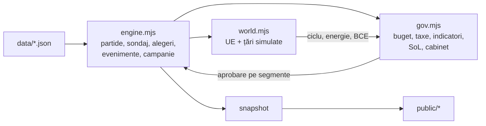

# Model de date

Tot conținutul de joc e JSON, în `data/`. Motorul nu are altă sursă de adevăr. Lista fișierelor
e în `shared/data-files.mjs` (serverul, testele și browserul o folosesc la fel).

Sumele de bani sunt în **milioane de euro (M€)**: bugetul statului, banii partidelor, costul
campaniilor și al deciziilor.

## Straturi



Guvernarea influențează sondajele: standardul de viață al fiecărui segment (SoL) față de
așteptările lui devine un multiplicator pentru partidele de la guvernare și pentru opoziție.

## Scenarii (`scenarios.json`)

Un scenariu fixează: data de start și a alegerilor, partidele, liderii, sondajul de start
(`startPoll`, la care motorul își calibrează puterea partidelor), mandatele din Parlament,
grupul minorităților, guvernul (premier, coaliție, sprijin, ministere și miniștri),
economia, bugetul și indicatorii de plecare.

```json
{ "id": "2026", "startDate": "2026-11-02", "electionDate": "2028-12-03",
  "parties": ["psd", "pnl", "usr", "aur", "udmr", "sos", "pot"],
  "leaders": { "psd": "grindeanu" },
  "startPoll": { "aur": 0.31 }, "parliament": { "psd": 86 }, "minoritySeats": 19,
  "government": { "pm": "niculescu", "pmParty": "psd", "coalition": ["psd"],
                  "support": ["pnl", "udmr"], "confidence": 52,
                  "ministries": { "finante": { "party": null, "minister": "nazare" } } },
  "economy": { "gdp": 388000, "growth": 0.9, "potential": 2.8, "inflation": 4.8,
               "tax": { "vat": 21 }, "revenue": { "vat": 7.4 }, "spend": { "pensions": 8.4 },
               "metrics": { "health": 55 }, "rating": { "level": "BBB-", "outlook": "negativ" } } }
```

`revenue` și `spend` sunt în % din PIB. Guvernele, rezultatele din 2016 și miniștrii sunt reale
(2017: Grindeanu la învestire; 2026: Niculescu la învestire). Sondajul de start din 2026,
economia și bugetul sunt estimări de joc.

### Partide extraparlamentare

`parties` din scenariu poate include formațiuni fără intrare în `parliament`: pornesc cu 0
mandate, `startPoll` sub 5% (2016: PRU 2,79%, PRM 1,04%, PER ~0,9%; 2024: SENS 2,99%,
Forța Dreptei 2,05%, PSDU 1,92%, REPER 1,24%, DREPT 1,16%) și se calibrează ca celelalte.
`leaders[id]` poate fi `null` (conducere colectivă) dacă nu există un lider verificat.

Fiecare partid candidează singur: 5% național sau 20% în patru județe (`snapshot.lists`).
Nu există alianțe electorale cu prag; în schimb partidele fuzionează (vezi Parlament).

## Parlament (`bills.json`, `splinters.json`, `shared/parl.mjs`)

- `bills.json`: legi cu `lean` (− piață, + intervenționism), `interest` (segment → −1..1) și
  `effects` (aceeași sintaxă ca evenimentele: `sol`, `metric`, `macro`, `budget`, `party`, `funds`).
  `party.self` e inițiatorul.
- `state.parl`: `bills` (voturi deschise, `kind` `law` sau `motion`), `rel` (relații 0–100 pe
  perechi, `a|b` sortat), `passed`, `done`, `mergeOffers`, `cool`.
- Înclinația unui partid față de o lege: interesele lui (afinitate × interes), distanța `lean`,
  relația cu inițiatorul, rolul (guvern/opoziție) și înțelegerile (`deals`, `pledged`). Coeziunea
  mută o parte din voturi în sens opus. Moțiunea trece cu 166 de voturi.
- Culise: `favor` (capital politic), `money` (M€, 15% risc de scandal), `swap` (votezi legea lor).
  Prețul scade cu relația; sub 15 nu mai vorbesc.
- `state.defs`: definiții de partid modificate (fuziuni, plecări, schimbarea direcției); citește
  mereu prin `partyDef(state, data, id)`. `state.renamed` ({vechi: nou}) se consumă cu
  `consumeRenamed`, ca jucătorul să continue cu noul grup.
- `fuse` (fuziune sau absorbție): sumă de mandate, fonduri și oameni; strength calibrată să
  rămână suma sondajelor. `splitParty`: oamenii cu cel mai mare traseism pleacă, împreună cu o
  parte din mandate și fonduri; șabloanele istorice sunt în `splinters.json`.
- La formarea guvernului `gov.formUntil` = ziua + 10: fiecare partid numește gratuit oamenii pentru
  ministerele lui (`appoint`).

## Guvernare (`government.json`, `policies.json`)

- `ministries`: 14 ministere, fiecare cu culoare și pârghiile pe care le controlează.
- `spendLines`: 9 linii de cheltuieli editabile (pensii, sănătate, educație, infrastructură…),
  cu intervalul permis față de nivelul de bază (`min`/`max`).
- `taxes`: TVA, impozit pe venit, impozit pe profit (elasticitate, efect asupra creșterii).
- `metrics`, `metricGroups`: indicatorii afișați în secțiunea Țara, cu cheia pentru media UE.
- `sol`: ponderile cu care fiecare segment își măsoară standardul de viață.
- `policies.json`: 31 de politici ale ministerelor. `spend`/`revenue` în % PIB pe an,
  `effects.sol` (puncte SoL), `drift` (indicator pe an), `lean` (-1 austeritate … +1 cheltuieli).

Cine poate schimba ce: o pârghie aparține ministerului care o controlează, iar ministerul
partidului care îl deține. Ceilalți din guvern trimit o **propunere**; partidele din opoziție
pot doar depune o moțiune. Partidul premierului poate face remanieri.

## Lume (`countries.json`)

`series["2017"|"2026"]` dă valorile de plecare pentru media UE și nouă țări, la 11 indicatori.
Valorile sunt orientative. `events` sunt evenimente globale sau pe țară, cu pondere, cooldown
și efecte mărginite (ciclu economic, energie, dobânda BCE, șocuri pe creștere/inflație/deficit).

## Partide, politicieni, segmente, județe

- `parties.json`: afinități pe segmente, bias pe județe, `lean` fiscal, `oppGain` (cât câștigă
  din nemulțumirea față de guvern). Puterea de start se calibrează per scenariu.
- `politicians.json`: `scenarios: { "2017": {…suprascrieri}, "2026": {} }` spune în ce scenarii
  există fiecare persoană și cum se schimbă rolul/partidul/faptele. `look` desenează portretul.
- `segments.json`: 10 segmente de votanți. `counties.json`: 42 de unități, cu indici de model.

## Evenimente (`events.json`)

```json
{ "id": "austeritate-invatamant", "scenarios": ["2017", "2026"], "months": [9, 10, 11],
  "weight": 7, "minDay": 10, "after": "alt-eveniment",
  "effects": {
    "segments": { "tineri_urbani": -0.05 },
    "convert": [{ "from": "studenti", "to": "diaspora", "share": 0.22 }],
    "county": { "hunedoara": { "convert": [], "party": { "psd": -0.08 } } },
    "party": { "gov": -0.02, "usr": 0.02 },
    "macro": { "growth": -0.2, "inflation": 0.3 }, "metric": { "cpi": -1 },
    "confidence": -6, "sol": { "bugetari": -3 }, "budget": { "admin": 0.2 },
    "funds": { "psd": -1.2 } } }
```

- `scenarios`, `months`: unde și când poate apărea.
- `after`: urmare a altui eveniment (apare în maximum 45 de zile, cu șanse de 4 ori mai mari).
- `choices` (+ `ignore`, `expires`): decizie pentru jucători. Fiecare alegere are `label`,
  `hint`, `text`, `cost` (M€) și `effects`; `self` = partidul care alege.
- În efecte, `gov`/`opp`/`self` înseamnă partidele de la guvernare, celelalte, respectiv jucătorul.
- `macro` adaugă șocuri (creștere, inflație, șomaj) care se estompează; `metric` mută direct un
  indicator; `sol` dă un șoc temporar standardului de viață; `budget` schimbă permanent o linie.

## Starea jocului

`createGame(data, { scenario, seed, humans })` produce o stare serializabilă:

```
scenario, day, date, speed (0 = pauză), electionDay, partyIds, leaders, strength, rng,
counties{ segments, boost }, parties{ funds, capital, seats, gov, segBoost, cooldown },
politicians, mood, govMult, coalitions[], offers[], negotiation, decisions[], fired{}, log[],
macro{ gdp, growth, inflation, unemployment, debt, rate… }, budget{ tax, ratio, paid, flows },
metrics{ health, education, infra, safety, cpi, arope, lifeExp, motorwayKm… },
sol, solExpect, sat, comp, gov{ pm, coalition, support, ministries, confidence },
policies{}, proposals[], rating{}, hist{}, world{ cycle, energy, ecb, countries }
```

`tick(state, data, days)` avansează ceasul: campania și AI-ul în fiecare zi, iar la fiecare 30
de zile lumea (`worldMonthly`) și guvernarea (`govMonthly`: venituri, cheltuieli, datorie,
rating, creștere, inflație, servicii, emigrare, SoL, încredere, AI de guvernare).
`snapshot(state, data)` e ce primește UI-ul (fără seria lungă `hist` dacă `opts.hist` e fals).

## Fluxuri

1. Acțiune de campanie: `applyAction` → cost în M€, cooldown, boost pe județ/segmente.
2. Acțiune de guvern: `applyGov` → `govAction` verifică proprietatea pârghiei, cooldown și
   capitalul politic; fie execută, fie creează o propunere pentru ministerul altui partid.
3. Decizie: `fireEvent` creează decizii pentru jucători; `decide` aplică efectele alegerii.
4. Cădere de guvern: încrederea sub 18 sau o moțiune → `fallGovernment` → formare nouă
   (negocieri de 10 zile, apoi `formGovernment` împarte ministerele proporțional).
5. Alegeri la data fixă: mandate prin D'Hondt, coaliții, guvern nou, ministere redistribuite.
